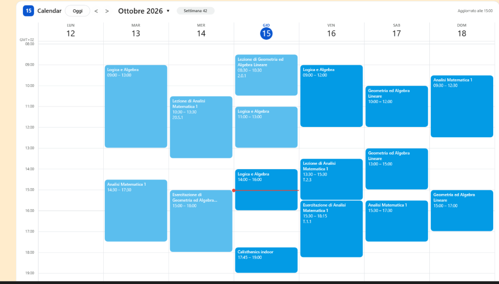

# WeeklyCalendar for Rainmeter

A Google Calendar-style planner for your desktop, built for [Rainmeter](https://www.rainmeter.net/).
It shows your Google Calendar (or any iCalendar `.ics` feed) with Google's look, and with a small
Google Apps Script also your Google Tasks and your contacts' birthdays. You can create, edit, move
and delete events and tasks without opening the browser.



---

## Features

**Looks and views**
- Google Calendar's Material 3 look: today's circle, the red "now" line, past events fading, declined invitations outlined. Light and dark themes.
- Day, 3-day, week and month views, switched from the toolbar.
- Quick search & Go to date: click the month/year title in the toolbar to search events and tasks or jump to any date (`15/12`, `marzo 2027`, `+14`).
- Countdown pill: pin any future event, task or date as a countdown in the toolbar (e.g. `Esame Analisi · -14g` / `Exam · -14d`), with one click to jump to that date.
- Up to 6 calendars, each in its own colour. Public holidays and birthdays too.
- Tooltips with the full title, time, place and description of every item.
- English and Italian.

**Events**
- Create one by clicking an empty spot of the hours, or the **+** button. A card like Google Calendar's opens.
- Details, edit, duplicate and delete (with Undo). Repeats, places, descriptions, calendars and per-event Google Calendar colours (all 11 colours, read from your calendar and chosen in the card) are supported, and a recurring event can be changed one occurrence at a time or all together.
- Place suggestions while you type an address (OpenStreetMap).
- Drag an event to another time or day, or drag its bottom edge to change how long it lasts.
- Recurring events are expanded in the skin (`RRULE`, `RDATE`, `EXDATE`, modified occurrences) with time zone conversion.

**Tasks** (Google Tasks)
- Tasks appear like in Google Calendar: ○ open, ✓ completed, with a short tag for their list (`ShowTaskList`). Click the circle to complete one.
- Drag a task to another day, move it to another list, add details.
- Priorities: a coloured dot, and the important tasks first in their day.
- Completed tasks fold into one line per day ("✓ 3 completed"), or show their titles, or are hidden.
- **Move to today**: one click brings the unfinished tasks of past days to today, with Undo.
- A busy day never hides anything: "+N more" expands the row, and a day that still does not fit scrolls with the mouse wheel.

**On your desktop**
- Settings panel: click the gear icon in the toolbar (or right-click > *Settings...*) to change views, theme, calendar colours, opacity, mouse actions and more with live preview.
- Resize it with the grip in the bottom right corner, or pick small, medium or large.
- Minimize it to a small tile with today's date and the next events.
- See the wallpaper: a see-through background, fading while the mouse is away, and the empty hours left out.
- Dialogs you open (e.g. "Empty Recycle Bin") always appear above the calendar.
- In the afternoon the hours shift down by themselves, so the evening stays in view.

---

## Installation

1. Install **[Rainmeter](https://www.rainmeter.net/)** 4.5 or newer (Windows 10 or 11).
2. Download or clone this repository into your skins folder:
   `C:\Users\<YourUsername>\Documents\Rainmeter\Skins\WeeklyCalendar`
3. In Rainmeter **Manage**, expand `WeeklyCalendar`, select `WeeklyCalendar.ini` and click **Load**.
   The skin creates `@Resources\Private.inc`, where your calendar addresses go.
4. Link your calendar (below).

To have the calendar back after every sign-in, Rainmeter has to start with Windows: if the installer
did not add it, press `Win + R`, run `shell:startup` and put a shortcut to
`C:\Program Files\Rainmeter\Rainmeter.exe` there.

---

## Setup

The skin reads two files in `@Resources`. After saving either one, right-click the skin >
**Refresh skin**.

- **`Settings.inc`**: your preferences. Most of them can also be changed directly in the calendar
  with a live preview: click the gear icon in the toolbar or right-click > **Settings...** (saved in
  `Private.inc`). To edit the file directly, right-click the skin > **Settings file**. Every setting
  is explained in the file; the most useful ones are [listed below](#settings).
- **`Private.inc`**: your calendar addresses and secrets. Right-click the skin > **Calendar
  addresses**. Git ignores it. The skin also writes your settings, the view, the size and the
  minimized state there.

> **Keep your addresses private.** Anyone with your secret iCal address can read your calendar,
> and anyone with the Tasks script's address can change your tasks and events (unless you set a
> [`TasksToken`](#protecting-the-changes)). Do not paste them into `Settings.inc`.

### Linking your Google Calendar
1. In [Google Calendar](https://calendar.google.com/): gear icon > **Settings** > your calendar's
   name > **Integrate calendar**.
2. Copy the **Secret address in iCal format**.
3. Paste it after `IcalUrl1=` in `Private.inc`, save, and refresh the skin.

Other calendars go after `IcalUrl2=` ... `IcalUrl6=`, each in its colour (`EventColor1` ...
`EventColor6` in `Settings.inc`). For public holidays, take the **Public address in iCal format** of
the "Holidays in ..." calendar. For Italy:
```ini
IcalUrl2=https://calendar.google.com/calendar/ical/it.italian%23holiday%40group.v.calendar.google.com/public/basic.ics
```
Declined invitations are recognised from your Google address; for other providers, put your
address(es) after `MyEmail=` in `Private.inc`.

### Showing Google Tasks
Google's iCal addresses never include tasks, so a small Google Apps Script (free, running in your
own Google account) publishes them. The same script saves the changes you make in the skin and
publishes the birthdays. It takes about 5 minutes, once:

1. On [script.google.com](https://script.google.com/) click **New project**, replace the sample code
   with the whole of `tools\GoogleTasksFeed.gs` and save (Ctrl+S).
2. In the sidebar, click **+** next to **Services**, add **Google Tasks API**, then
   **Google Calendar API** (needed for events and birthdays).
   <details><summary>If that dialog does not open</summary>

   **Project Settings** (gear icon) > tick *Show "appsscript.json" manifest file in editor*, open
   `appsscript.json` and add inside the outer braces:
   ```json
   "dependencies": { "enabledAdvancedServices": [
     { "userSymbol": "Tasks", "version": "v1", "serviceId": "tasks" },
     { "userSymbol": "Calendar", "version": "v3", "serviceId": "calendar" } ] },
   ```
   </details>
3. Select the function `authorize` and click **Run**. Allow access (*Advanced* > *Go to (project
   name)* > **Allow**). The log must end with `OK: the skin can now change your calendar too.`
4. **Deploy** > **New deployment** > gear icon > **Web app**; *Execute as*: **Me**, *Who has
   access*: **Anyone**. Click **Deploy** and copy the **Web app URL**.
5. Paste it after `IcalUrl3=` (or any free slot) in `Private.inc`, save and refresh the skin.

Tasks with a due date appear in the all-day row of their day. A task that has a time in the Google
apps shows at that time when your Google calendar is in the skin too. Saving a change needs
`curl.exe`, which Windows 10 and 11 include.

#### Protecting the changes
Recommended: without a secret, anyone who has the web app URL can change your tasks and events.

1. Generate a long random value, for example in PowerShell (it goes to the clipboard):
   ```powershell
   $c = [char[]]'ABCDEFGHIJKLMNOPQRSTUVWXYZabcdefghijklmnopqrstuvwxyz0123456789'
   $b = [byte[]]::new(40); [Security.Cryptography.RandomNumberGenerator]::Create().GetBytes($b)
   -join ($b | ForEach-Object { $c[$_ % 62] }) | Set-Clipboard
   ```
2. In the script: **Project Settings** > **Script properties** > **Add script property**:
   `WRITE_TOKEN` with that value. No new deployment is needed.
3. In `Private.inc` add `TasksToken=` followed by the same value, and refresh the skin.

If the two values differ, every change is refused ("bad token" in the toolbar's tooltip).

### Birthdays
Google's iCal address leaves out your contacts' birthdays; the Tasks script publishes them (it needs
the **Google Calendar API** service). Put the script's web app URL followed by `?feed=birthdays` in
a free slot:
```ini
IcalUrl4=https://script.google.com/macros/s/.../exec?feed=birthdays
```
Optional: `EventColor4=51,182,121,255` in `Settings.inc` gives them Google's birthday green.

### Updating the Tasks script
When the toolbar or a card says **update the Tasks script**, the skin needs a newer
`tools\GoogleTasksFeed.gs`. The web app URL stays the same:

1. On [script.google.com](https://script.google.com/) replace the code with the new
   `tools\GoogleTasksFeed.gs` and save. Add the **Google Calendar API** service if it is missing.
2. Run `authorize` and allow access if Google asks (tick every checkbox).
3. **Deploy** > **Manage deployments** > pencil icon > *Version*: **New version** > **Deploy**.
   Do not create a *new deployment*: it would get a new URL.

If `authorize` fails without asking for permission: in `appsscript.json` (see step 2 of
[Showing Google Tasks](#showing-google-tasks)) add
`"oauthScopes": ["https://www.googleapis.com/auth/tasks", "https://www.googleapis.com/auth/calendar"],`
inside the outer braces, save, run `authorize` again and deploy a new version.

---

## Using the calendar

### Creating and editing
- **Create**: click an empty spot of the hours (an event at that time), of the all-day row or a
  day number (a task), or **+** in the toolbar. Type the title and press **Enter**.
  Before saving you can switch *Event* / *Task*, tick *All day*, and change the date and times:
  click one and type it (`31/10`, `31 oct`, `tomorrow`, `fri`, `+2`; `9`, `930`, `9:30 pm`) or use the
  mouse wheel over it. Add a place, a description, a repeat, a calendar and an event colour; for a task, details and
  its list. *More options* opens Google Calendar's own editor.
- **Details**: click an event or task. From the card: **Edit**, **Duplicate**, **Delete**, open it
  in Google Calendar. A recurring event asks *This event* or *All events*. A deletion can be undone
  for 8 seconds (`UndoSeconds`) before it reaches Google.
- **Drag**: move an event to another time or day (15-minute steps), drag its bottom edge to change
  its end, drag a task or an all-day event to another day. Right-click or leave the skin to cancel.

Changes show at once. Google's iCal address can take a while to show a change to an event, so the
skin keeps showing it until the feed has it. If Google refuses a change, the item goes back and the
toolbar says why.

Read-only: holiday calendars, birthdays, other providers, and invitations organised by someone
else (the card says why). Google's Tasks API cannot set a task's time, star a task or make it
repeat; tasks without a date are not shown.

### Tasks
- **Completing tasks**: click the ○ at the start of a task (the ✓ reopens it). For a task shown at
  its time: right-click it > *Mark complete*.
- **Completed tasks** (`CompletedTasks`): `count` shows one line, **✓ 3 completed**: its tooltip
  lists them, a click shows them in the day. `titles` shows each one struck through, `hide` none.
- **Priority**: in a task's card, click *No priority* to go to *Medium*, *High* and back. Google
  Tasks has no priority field, so it is kept as a last line `[P1]` (high) or `[P2]` (medium) of the
  task's notes: it follows you to other devices, and the skin hides it.
- **Move to today (3)** in the toolbar brings the unfinished tasks of past days (up to 60 days back)
  to today, with **Undo** for a few seconds. It shows only when there are some.
- **A busy day**: the last row says **+5 more**, and its tooltip lists them. Click it to expand the
  row. If the day still does not fit, scroll its rows with the mouse wheel (a thin bar at the right
  shows where you are) or click **+N more** again to go to the last ones. ▲ at the left collapses it.

---

## Controls

| Action | How |
| :--- | :--- |
| Scroll the hours | Mouse wheel over the calendar, or ▲ / ▼ in the hours column |
| Previous / next day, week or month | `<` / `>` in the toolbar, or mouse wheel over the toolbar or the day names |
| Change view | **Day**, **3 days**, **Week**, **Month** in the toolbar |
| Back to today | **Today** in the toolbar |
| Search / go to a date | Click the month/year title or the week badge in the toolbar, or right-click > *Search / Go to date...* |
| Countdown to a date | Click **Countdown** in an event/task's card or in the search card (or set `CountdownDate` / `CountdownTitle`); click the toolbar pill to jump to that date, middle-click it to clear |
| Events before / after the visible hours | Click the `▲ n` / `▼ n` badge of the day |
| Open an item | Click: its card. Middle-click: Google Calendar |
| Open a day | Month view: click the day. Middle-click "+N more": the day in Google Calendar |
| Scroll a busy day's all-day row | Mouse wheel over it (once expanded) |
| Resize the skin | Drag the grip in the bottom right corner, or right-click > *Size* |
| Move the skin | Drag an empty part of the toolbar, the day names or the hours column |
| Change the settings | Gear icon in the toolbar, or right-click > *Settings...* |
| Minimize | **—** at the right of the toolbar; click the tile to open the calendar again |
| Sync now | Click the sync time in the toolbar, or right-click > *Refresh now* |

---

## Settings

Click the gear icon in the toolbar (or right-click > **Settings...**) to change the main settings
with a live preview (**Defaults** resets them). All settings are also documented in `Settings.inc`
(right-click > **Settings file**). The ones you are most likely to change:

| Setting | Default | What it does |
| :--- | :--- | :--- |
| `Language` | `en` | `en` or `it` |
| `Theme` | `light` | `light` or `dark`; any single colour can be overridden |
| `View` | `week` | First view: `day`, `3day`, `week`, `month` (the toolbar remembers your choice) |
| `FirstDay` | `1` | First day of the week: 1 Monday, 0 Sunday |
| `Width`, `Height` | `1400`, `800` | Size (the grip and the menu override it) |
| `StartHour`, `EndHour` | `8`, `20` | Hours shown |
| `AutoScroll`, `AutoScrollHour` | `1`, `14` | Shift the hours down in the afternoon |
| `HideEmptyHours` | `1` | Leave out the hours without events |
| `AllDayRows` | `3` | All-day rows before "+N more" (1-10) |
| `CompletedTasks` | `count` | `count`, `titles` or `hide` |
| `ShowTaskList` | `short` | Task list on the chip: `short`, `full` or `hide` |
| `EventColor1` ... `6` | Google's colours | Colour of each calendar |
| `ClickAction` | `card` | Left click: `card`, `calendar` (Google Calendar) or `link` (the event's link) |
| `BgOpacity`, `IdleBgOpacity` | `100`, `90` | Background opacity (%) with the mouse over the skin, and away |
| `IdleOpacity`, `IdleSeconds` | `60`, `3` | The whole skin fades this much when the mouse has been away this long |
| `ShowMinimizeButton`, `MiniEvents` | `1`, `3` | Minimize button; events listed on the tile |
| `ShowOverdueButton` | `1` | The **Move to today** button |
| `CountdownDate`, `CountdownTitle` | empty | Target date (`YYYY-MM-DD` or `DD/MM/YYYY`) and optional label for the toolbar countdown pill |
| `ClickToCreate`, `ShowCreateButton` | `1`, `1` | Create by clicking an empty spot, the **+** button |
| `DragToMove`, `RightClickCard` | `1`, `1` | Drag to move; right-click for the card |
| `UndoSeconds` | `8` | Time to undo a deletion |
| `PlaceSuggestions`, `PlaceSearchNear` | `1`, empty | Place suggestions, and the town they are nearest to |
| `ShowDeclined` | `1` | Show declined invitations (outlined) |
| `ZPos`, `KeepDialogsOnTop` | `-2`, `1` | Keep the calendar on the desktop, below the windows you open |

**The helper.** `@Resources\ZOrder` holds a tiny helper that the skin compiles on first load with
the C# compiler included in Windows. It keeps dialogs above the calendar, keeps what you type in a
card when you click elsewhere instead of pressing Enter, follows the cursor while you resize,
searches the place suggestions (it sends only what you type in the place box, to
[Photon](https://photon.komoot.io/), [OpenStreetMap](https://www.openstreetmap.org/copyright) data),
and puts back a calendar dropped over the taskbar. It uses no CPU while idle and exits with Rainmeter.

---

## Troubleshooting

Problems show next to the sync time in the toolbar; hover it for the details.

| Toolbar says | What to do |
| :--- | :--- |
| **No calendar configured** | Paste an address in `Private.inc` ([Linking your Google Calendar](#linking-your-google-calendar)) |
| **offline** | A feed could not be downloaded; the skin keeps showing the last copy |
| **feed error** | A file is not a calendar: check the address (for the Tasks script, the tooltip shows its answer) |
| **update the Tasks script** | [Updating the Tasks script](#updating-the-tasks-script) |
| **allow editing tasks** / **allow calendar access** | Add the missing service, run `authorize`, deploy a new version |
| **task not saved** / **change not saved** | Google did not confirm. "bad token": `TasksToken` differs from the script's `WRITE_TOKEN` |

For anything else, look for lines starting with `WeeklyCalendar` in Rainmeter > Manage > **Log**.

---

## Development

```plaintext
WeeklyCalendar/
├── WeeklyCalendar.ini        # The skin (meters and measures)
├── @Resources/
│   ├── Calendar.lua          # iCal parser, recurrences, layout, cards
│   ├── Settings.inc          # Preferences
│   ├── Private.inc           # Addresses and secrets (git-ignored, created on first load)
│   └── ZOrder/               # The helper (C# source and launcher)
├── tools/
│   ├── GoogleTasksFeed.gs    # The Tasks script (Google Apps Script)
│   ├── LiveTest.ps1          # Drives the real skin with real mouse and keyboard input
│   └── textconv-utf16.py     # Readable git diffs of Calendar.lua
├── tests/run_tests.py        # Test suite (Calendar.lua against a mock Rainmeter)
└── docs/plans/README.md      # Conventions and traps: read it before changing the code
```

- `Calendar.lua` must stay **UTF-16 LE with BOM** (Rainmeter 4.5 needs it for UTF-8 text). For
  readable diffs: `git config diff.utf16.textconv "python tools/textconv-utf16.py"`.
- Tests: `pip install lupa`, then `python tests/run_tests.py`. With [Node.js](https://nodejs.org/)
  installed they also run the Tasks script against fake Google APIs.
- Live checks (tooltips, dragging, the wheel): `pwsh -File tools\LiveTest.ps1 -Front -Steps "..."`;
  its header lists the steps.

---

## License

[CC0 1.0 Universal (Public Domain)](LICENSE).
