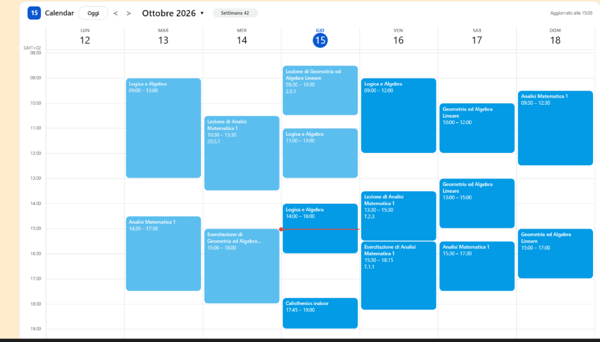

# WeeklyCalendar for Rainmeter

A sleek, modern, Google Calendar (Material 3) weekly planner skin for [Rainmeter](https://www.rainmeter.net/).

Powered directly by Google Calendar (or any standard iCalendar / `.ics` feed), it expands recurring events (`RRULE`, `RDATE`, `EXDATE`, `RECURRENCE-ID`), converts timezones (`VTIMEZONE`, plus built-in rules for common zones), and provides smooth interactive navigation on your desktop. With a small Google Apps Script it also shows Google Tasks and your contacts' birthdays, and creates, edits, moves and deletes events and tasks.



---

## Features

- **Google Calendar Material 3 Design**: Clean typography, Google Calendar pastel color scheme, subtle borders, today indicator circle, and red live "now" line.
- **Day, 3-Day, Week and Month Views**: A segmented switcher in the toolbar (Day / 3 days / Week / Month, like Google Calendar) changes the view at once and remembers it; wide day columns also show the first line of each event's description. The month view lists each day's all-day items and events ("+N more" when a day is full); click a day to open it in the day view.
- **Vertical Hour Scrolling**: Scroll the mouse wheel over the calendar grid or use the time-gutter buttons (▲ / ▼) to navigate through hours at any time.
- **Auto-Scroll for Evening Plans**: In the afternoon and evening (after 2:00 PM / 14:00 by default), the visible time window automatically shifts down so upcoming commitments after 19:00 (7 PM) through midnight are always in plain sight without manual scrolling.
- **Multi-Calendar Support**: Sync up to 6 distinct iCal feeds simultaneously, each with its own color.
- **Smart Recurrence & Overrides**: Client-side parsing of RFC 5545 recurrence rules (`DAILY`, `WEEKLY`, `MONTHLY`, `YEARLY`, including `BYSETPOS` such as "last weekday of the month"), extra dates (`RDATE`), exceptions (`EXDATE`), and modified occurrences (`RECURRENCE-ID`).
- **All-Day Events & Timed Events**: Dedicated all-day events row at the top (3 rows by default, `AllDayRows`; click "+N more" to expand the row like Google Calendar, ▲ to collapse it) and column-packed overlapping timed events throughout the week.
- **Hidden Events Indicators**: When events fall outside the visible hours, a `▲ n` badge next to the day number (earlier) or a `▼ n` badge under the column (later) shows how many there are; hover for the list, click to scroll to them.
- **Google Tasks**: Tasks appear like in Google Calendar (○ open, ✓ completed): in the all-day row, or at their time when they have one. Click the circle to mark a task completed (or the check mark to reopen it), or drag it to another day. Each task shows its list and its details (notes); a new or edited task can go to any of your lists.
- **Holidays & Birthdays**: Public holidays come from Google's holiday calendars; your contacts' birthdays, which Google's iCal address leaves out, come from the Tasks script.
- **Create Events and Tasks**: Click an empty spot of the hours (an event at that time), of the all-day row or a day number (a task), or the **+** in the toolbar: a card like Google Calendar's opens, you type the title and press Enter. An event can also get a place, a description, a repeat (every day, weekday, week, month, year) and a calendar; a task its details and its list. The item appears at once and Google saves it.
- **Details, Edit, Delete**: Right-click an event or task for its details; edit its title, date and times, place and description (all day or not), a task's details and list, one occurrence or every occurrence of a recurring event; or delete it (one occurrence or the whole series) with a few seconds to undo.
- **Drag Events**: Drag an event to another time or day (snapped to 15 minutes, like Google Calendar), or an all-day event to another day; in the month view, events move to another day and keep their time. A click that slips a few pixels stays a click.
- **Open in Google Calendar**: Click an event to open it in Google Calendar (a task opens its day); middle-click opens the event's video call or link (Meet, Zoom, Teams...). `ClickAction=link` swaps the two.
- **Declined Invitations**: Invitations you declined are drawn outlined, like Google Calendar, or can be hidden (`ShowDeclined=0`).
- **Past Event Fading**: Events fade as soon as they end, just like in Google Calendar.
- **Detailed Tooltips**: Hover over any event or task to see its full title, start/end time, location and description (rich text and Google Meet details are cleaned up).
- **Dialogs Always on Top**: Windows and dialogs you open (e.g. "Empty Recycle Bin") always appear above the calendar, even in Windows' "Show desktop" mode.
- **Dark & Light Themes**: `Theme=light` or `Theme=dark`, matching Google Calendar; any single color can still be overridden.
- **English & Italian**: Labels, tooltips and the right-click menu follow `Language`.
- **Unicode Titles**: Accented and non-Latin characters in event titles display correctly.
- **Configurable Mouse**: Every way of changing your calendar from the skin (click to create, the + button, dragging, the right-click card) can be turned off in `Settings.inc`.

---

## Installation

1. Make sure you have **[Rainmeter](https://www.rainmeter.net/)** installed (version 4.5 or newer) on
   Windows 10 or 11.
2. Download or clone this repository into your Rainmeter skins directory:
   ```plaintext
   C:\Users\<YourUsername>\Documents\Rainmeter\Skins\WeeklyCalendar
   ```
3. Open Rainmeter **Manage**, expand `WeeklyCalendar`, select `WeeklyCalendar.ini`, and click **Load**.
   On first load the skin creates `@Resources\Private.inc`, where your calendar addresses go.
4. Link your calendar (see below).

---

## Configuration

The skin reads two files in `@Resources`. After saving either, right-click the skin > **Refresh skin**.

- **`Settings.inc`**: your preferences (hours, size, colors, language, what the mouse may do).
  Right-click the skin > **Calendar settings**. Every setting is explained in the file.
- **`Private.inc`**: your private addresses and secrets. Right-click the skin > **Calendar addresses**.
  It is listed in `.gitignore`, so it is never committed.

What `Private.inc` holds:

| Key | What it is |
| :--- | :--- |
| `IcalUrl1` ... `IcalUrl6` | Calendar addresses: Google Calendar's secret iCal address, a holiday calendar, the Tasks script, its birthdays address, or any `.ics` feed |
| `MyEmail` | Optional: your address(es), comma separated, to recognize declined invitations from providers other than Google |
| `TasksToken` | Optional: the secret that protects the Tasks script's changes (see [Creating and editing](#4-creating-and-editing)) |
| `View` | The view last picked in the toolbar (written by the skin) |

> **Security Warning**: Keep your secret iCal address and the Tasks script's address private! Anyone with them can view your schedule, and with the script's address also change your tasks and events (unless `TasksToken` is set). Do not paste them into `Settings.inc`.

### 1. Linking your Google Calendar
1. Open [Google Calendar](https://calendar.google.com/) in your browser.
2. Click the settings gear icon > **Settings**.
3. Under *Settings for my calendars*, click your calendar name.
4. Scroll down to the **Integrate calendar** section.
5. Copy the **Secret address in iCal format** (`https://calendar.google.com/calendar/ical/.../basic.ics`).
6. Right-click the skin > **Calendar addresses** (opens `@Resources\Private.inc`) and paste it directly after `IcalUrl1=`:
   ```ini
   IcalUrl1=https://calendar.google.com/calendar/ical/your_address_here/basic.ics
   ```
7. Save the file, then right-click the skin > **Refresh skin**.

Up to 6 calendars can be shown, each in its own color (`EventColor1` ... `EventColor6` in
`Settings.inc`): put the other addresses after `IcalUrl2=` ... `IcalUrl6=`. A `Private.inc` created
by an older version only lists `IcalUrl1..3`: add the lines `IcalUrl4=`, `IcalUrl5=` and
`IcalUrl6=` by hand when you need them.

### 2. Public holidays
Google's holiday calendars have a public iCal address. For Italy, add to `Private.inc`:
```ini
IcalUrl2=https://calendar.google.com/calendar/ical/it.italian%23holiday%40group.v.calendar.google.com/public/basic.ics
```
For another country: Google Calendar > Settings > the "Holidays in ..." calendar > **Public address in iCal format**.

### 3. Google Tasks (the Tasks script)
Google never includes tasks in iCal addresses, so a tiny Google Apps Script (free, runs on your
own Google account) publishes them as a private iCal address. The same script also creates, edits
and deletes items for the skin and publishes your birthdays. One-time setup, about 5 minutes:

1. Open [script.google.com](https://script.google.com/) and click **New project**.
2. Delete the sample code and paste the whole content of `tools\GoogleTasksFeed.gs`. Save (Ctrl+S).
3. In the left sidebar, click the **+** icon next to **Services**, pick **Google Tasks API**, click
   **Add**. Do the same for **Google Calendar API** (needed to create and change events and for
   birthdays; tasks work without it).
   If that dialog does not open: **Project Settings** (gear icon) > tick *Show "appsscript.json"
   manifest file in editor*, open `appsscript.json` and add inside the outer braces:
   ```json
   "dependencies": { "enabledAdvancedServices": [
     { "userSymbol": "Tasks", "version": "v1", "serviceId": "tasks" },
     { "userSymbol": "Calendar", "version": "v3", "serviceId": "calendar" } ] },
   ```
4. In the toolbar, select the function `authorize` and click **Run**. Google asks for permission:
   choose your account, then *Advanced* > *Go to (project name)* > **Allow**. The log must end with
   `OK: the skin can now change your calendar too.` (without the Calendar service it says how to
   add it). The function `test` shows the beginning of the tasks feed in the log.
5. Click **Deploy** > **New deployment** > gear icon > **Web app**, then set
   *Execute as*: **Me** and *Who has access*: **Anyone**. Click **Deploy** and copy the **Web app URL**
   (`https://script.google.com/macros/s/.../exec`).
6. Paste it in `Private.inc` after `IcalUrl3=` (or any free slot), save and refresh the skin.

Tasks with a due date appear in the all-day row of their day, in the `EventColor` of the slot you
used; hover a task to see its list and its description (notes). The Tasks API keeps only the date, but a task
that has a time in the Google apps shows at that time when your Google calendar is also in the
skin: Google's iCal address lists such a task as a free event with the same title, and the skin
shows the two as one task.

**Completing**: click the circle ○ at the start of a task to mark it completed, or the check mark
✓ to mark it not completed (for a task shown at its time: right-click it > *Mark complete*). The
skin shows the change at once and Google Tasks saves it through the web app (it needs `curl.exe`,
included in Windows 10 and 11). If Google does not confirm, the task goes back to how it was and
the toolbar says why.

**Moving**: drag a task to another day and release it there: the day under the cursor (a column,
or a cell in the month view) is highlighted, the task is previewed where it will land and the
toolbar says where it will go. A plain click still opens the task's day in Google Calendar.
Release it on its own day, right-click or leave the skin to cancel. Dragging works in the 3-day,
week and month views (the day view has no other day to drop it on). Two limits of the Tasks API:
a task that has a time keeps only its new date, and moving one occurrence of a repeating task may
detach it from the series (the feed cannot tell which tasks repeat).

### 4. Creating and editing
With the Tasks script set up as above (including the **Google Calendar API** service), the skin
creates, edits, moves and deletes tasks and Google Calendar events. If you set up the script
before version 1.11.0, update it first ([Updating the Tasks script](#6-updating-the-tasks-script)).

Recommended: anyone who has the web app URL can change your tasks and events. Protect the changes
with a secret:

1. Generate a long random value, for example in PowerShell (it copies the value to the clipboard):
   ```powershell
   $c = [char[]]'ABCDEFGHIJKLMNOPQRSTUVWXYZabcdefghijklmnopqrstuvwxyz0123456789'
   $b = [byte[]]::new(40); [Security.Cryptography.RandomNumberGenerator]::Create().GetBytes($b)
   -join ($b | ForEach-Object { $c[$_ % 62] }) | Set-Clipboard
   ```
2. In the script: **Project Settings** (gear icon) > **Script properties** > **Add script property**:
   `WRITE_TOKEN` with that value > **Save script properties**. No new deployment is needed.
3. In `Private.inc`, add the same value and refresh the skin:
   ```ini
   TasksToken=the same long random value
   ```

If the two values differ, every change is refused ("bad token" in the toolbar's tooltip). Reading
the feeds does not need the token.

How it works:
- **Create**: click an empty spot of the hours (an event at that half hour, one hour long), of
  the all-day row or a day number (a task for that day), or **+** in the toolbar (today, the next
  half hour). Type the title and press **Enter**. Before that you can switch *Event* / *Task*,
  tick *All day*, and change the times: click one and type it (`9`, `930`, `9:30`, `9:30 pm`),
  then Enter; a new start keeps the event's length. The **mouse wheel** over the date or a time
  changes it too (a day, 15 minutes).
  An event also has *Does not repeat* (click it to choose every day, every weekday, every week,
  month or year), *Add location*, *Add description* and its calendar (any Google calendar shown in
  the skin); a task has *Add details* and its list (all your Google Tasks lists). Click a text
  to type it and press **Enter** to keep it (**Ctrl+Enter** starts a new line in details and
  descriptions); a click elsewhere before Enter drops what was typed in that box. Click a choice
  (▾) to list the others, or scroll over it to go to the next one. *More options*
  opens Google Calendar's own editor, filled in. Esc closes the title box; a click outside closes
  the card. Without the script the card offers *Open in Google Calendar* instead.
- **Details**: right-click an event or task. Holiday calendars, birthdays, public addresses, other
  providers and invitations organised by someone else are read-only; the card says why.
- **Edit**: *Edit* in the card; type the new title and press Enter, or change the date (and the
  times of an event: click a time to type it, or use the wheel), the place, the description,
  *All day* (an event that does not repeat), a task's details or list, and click *Save*. Only what
  you changed is sent. A recurring event then asks *This event* or *All events*: all events take
  the new title, place, description and time of day (the date of a single occurrence changes
  only that one). A task moves to another list with its id there; Google refuses to move a
  repeating task to another list. A description with formatting (written in Google Calendar,
  or with a video call) is changed in Google Calendar.
- **Delete**: *Delete* in the card (a recurring event asks: *This event* / *All events*). The item
  disappears and a bar offers **Undo** for 8 seconds (`UndoSeconds`); the request goes to Google
  only after that (a skin refresh in those seconds keeps the item).
- **Drag**: press an event and move it: a preview shows the new time (15-minute steps) and the
  toolbar says where it goes; release to move it. A plain click still opens it, even if the mouse
  slips a few pixels while pressing. Right-click or leave the skin to cancel. Events spanning
  several days are moved from Google Calendar.

What Google's Tasks API does not offer, so the skin cannot either: the time of a task (set it in
Google Tasks; the skin shows it), starring a task and repeating tasks. Tasks without a date are not
shown: a calendar has no day for them.

Lists, details, places, descriptions, repeats and *All events* need the Tasks script of version
1.14.0: with an older one the card says to update it
([Updating the Tasks script](#6-updating-the-tasks-script)).

Changes show at once. Google's iCal address can take minutes (sometimes hours) to show a change
to an event, so the skin keeps showing it until the feed has it (24 hours at most); tasks update
within seconds. If Google refuses a change, the item goes back and the toolbar says why (hover
it).

Related settings in `Settings.inc`:
```ini
; Calendar new events go to (the card can pick another): empty = your primary calendar, or a
; calendar id (as in its iCal address, e.g. abc123@group.calendar.google.com)
CreateCalendar=
; Task list new tasks go to (the card can pick another): @default = "My Tasks", or a list id
; (X-WC-LIST in the tasks feed)
TaskList=@default
; 1 = a click on an empty spot of the hours, the all-day row or a day number creates an item
; (0 = those spots do nothing; the + button still works)
ClickToCreate=1
; 1 = the + button in the toolbar
ShowCreateButton=1
; 1 = drag events and tasks to move them (0 = a press just opens them, nothing moves)
DragToMove=1
; 1 = right-click an event or task for its details, editing and deleting (0 = the skin menu)
RightClickCard=1
; Seconds a deletion can be undone before it goes to Google (2-60)
UndoSeconds=8
; Length of a new event in minutes (15-minute steps, default 60)
NewEventMinutes=60
```
With `RightClickCard=0` nothing can be edited or deleted from the skin; creating still works.

### 5. Birthdays
Google Calendar shows your contacts' birthdays, but its iCal address leaves them out. The Tasks
script publishes them (it needs the **Google Calendar API** service, step 3 of
[Google Tasks](#3-google-tasks-the-tasks-script)):

1. Take the script's web app URL and add `?feed=birthdays` at the end.
2. Paste it in a free slot of `Private.inc`, for example:
   ```ini
   IcalUrl4=https://script.google.com/macros/s/.../exec?feed=birthdays
   ```
3. Optional: give it Google's birthday color in `Settings.inc`: `EventColor4=51,182,121,255`.

Birthdays appear in the all-day row; a click opens one in Google Calendar. If the toolbar says
"feed error", hover it: the script says what is missing.

### 6. Updating the Tasks script
New versions of the skin may need the new `tools\GoogleTasksFeed.gs`: the toolbar then says
**"update the Tasks script"**, a new feature (creating events, birthdays) does not work, or the card
says to update it (task lists and details, places, descriptions, repeats: version 1.14.0). The web
app URL stays the same:

1. Open your project on [script.google.com](https://script.google.com/), replace the code with the
   new `tools\GoogleTasksFeed.gs` and save.
2. If it is not there yet, add the **Google Calendar API** service (step 3 of
   [Google Tasks](#3-google-tasks-the-tasks-script)).
3. Select `authorize` and click **Run**, and allow access if Google asks (if the screen has
   checkboxes, tick them all). The log must end with `OK: the skin can now change your calendar too.`
4. **Deploy** > **Manage deployments** > pencil icon > *Version*: **New version** > **Deploy**.
   Do not create a new deployment: that would give the script a new URL.

If Google does not ask for permission and `authorize` fails, declare the access by hand:
**Project Settings** (gear icon) > tick *Show "appsscript.json" manifest file in editor*, open
`appsscript.json`, add inside the outer braces
`"oauthScopes": ["https://www.googleapis.com/auth/tasks", "https://www.googleapis.com/auth/calendar"],`,
save, then run `authorize` again and deploy a new version.

### 7. Visible Hours & Auto-Scroll
```ini
; Base visible time range (whole hours, 0-24)
; Total visible hours on screen = EndHour - StartHour (e.g. 20 - 8 = 12 hours)
StartHour=8
EndHour=20

; AutoScroll=1: automatically shifts the visible hours down in the afternoon/evening
; so you can always see evening events past 19:00 (7 PM).
AutoScroll=1

; Hour of the day (0-23) after which the view automatically shifts down (default: 14 = 2:00 PM)
AutoScrollHour=14

; Rows of all-day events and tasks (1-10); "+N more" expands the row
AllDayRows=3

; Startup view: day, 3day, week or month (the switcher in the toolbar saves its choice in Private.inc)
View=week
```

### 8. Dimensions & Appearance
```ini
; Dimensions in pixels
Width=1400
Height=800

; Language: en (English) or it (Italian) - also used for tooltips and the right-click menu
Language=en

; First day of the week: 1 = Monday, 0 = Sunday, 6 = Saturday
FirstDay=1

; Event colors (R,G,B,A or hex), one per calendar slot
EventColor1=3,155,229,255
EventColor2=11,128,67,255
EventColor3=142,36,170,255
EventColor4=244,81,30,255
EventColor5=121,134,203,255
EventColor6=97,97,97,255

; Theme: light or dark. Individual colors (BgColor, TodayColor, ...) can be
; overridden by uncommenting them in Settings.inc
Theme=light

; Declined invitations: 1 = show outlined, 0 = hide
ShowDeclined=1

; What a left click on an event opens: calendar (Google Calendar; the middle click opens the
; event's link) or link (the event's link when it has one; the middle click opens Google Calendar)
ClickAction=calendar

; Window position: -2 = On Desktop (always visible), -1 = Bottom (hidden in "Show desktop" mode)
ZPos=-2

; 1 = windows and dialogs you open always appear above the calendar (see below)
KeepDialogsOnTop=1
```

In "Show desktop" mode (which recent Windows 11 builds also enter just by clicking the desktop)
Rainmeter keeps *On Desktop* skins above every window, so a dialog such as "Empty Recycle Bin"
could open behind the calendar. With `KeepDialogsOnTop=1` the skin starts a tiny helper
(`@Resources\ZOrder`, compiled on first load with the C# compiler included in Windows) that moves
the calendar just below whatever window you activate and puts it back when you return to the
desktop. It uses no CPU while idle and closes by itself when Rainmeter exits.

Declined invitations are recognized from the address in your Google iCal URL. For other
providers, add your address to `MyEmail=` in `Private.inc`.

---

## Controls & Shortcuts

| Action | Control |
| :--- | :--- |
| **Scroll Hours** | Mouse wheel over calendar body / events / time column |
| **Scroll Up / Down** | Click the ▲ / ▼ buttons in the time column gutter |
| **Show Hidden Events** | Click a `▲ n` / `▼ n` badge in a day column |
| **Change View** | Click **Day**, **3 days**, **Week** or **Month** in the toolbar (saved in `Private.inc`) |
| **Navigate** | Click `<` / `>` buttons in the toolbar, or mouse wheel over the toolbar / day headers: one day, three days or a week, depending on the view. In the month view the wheel anywhere changes the month |
| **Open a Day** | In the month view, click a day (or its "+N more") to see it in the day view; middle-click opens it in Google Calendar |
| **Jump to Today** | Click the **Today** button in the toolbar (also resets hour scroll) |
| **Open an Event** | Click it: opens it in Google Calendar (a task or "+N more": that day). Middle-click: its Meet / Zoom / Teams link |
| **All-Day Row** | Click `+N more` to show every all-day item (middle-click: open that day in Google Calendar); click ▲ at the left of the row to collapse it |
| **Complete a Task** | Click the ○ at the start of the task (✓ to reopen it); a task shown at its time: right-click > *Mark complete* |
| **Move a Task** | Drag it to another day (3-day, week and month views); right-click or leave the skin to cancel |
| **Create** | Click an empty spot of the hours (event), of the all-day row or a day number (task), or **+** in the toolbar; type the title, Enter (`ClickToCreate=0` / `ShowCreateButton=0` turn them off) |
| **Place, Description, Details** | Click *Add location*, *Add description* or *Add details* in the card, type, Enter (Ctrl+Enter: a new line) |
| **Repeat, Calendar, Task List** | Click the choice (▾) in the card and pick another; or scroll over it |
| **Change Date / Time in the Card** | Click the start or end and type it (`9`, `930`, `9:30`, `9:30 pm`), Enter; or mouse wheel over the date, start or end |
| **Details, Edit, Delete** | Right-click an event or task; *Undo* in the bar at the bottom within 8 seconds (`UndoSeconds`; `RightClickCard=0` shows the skin menu instead) |
| **Move an Event** | Drag it to another time or day (15-minute steps); right-click or leave the skin to cancel (`DragToMove=0` turns dragging off) |
| **Move the Skin** | Drag it by an empty area of the toolbar or the day headers: pressing an event, a task, a button or the grid does not move it |
| **Sync Calendar Now** | Click the sync time in the top-right corner, or right-click > *Refresh now* |
| **Context Menu** | Right-click an empty area of the skin: refresh, today, hour scrolling, *Calendar settings*, *Calendar addresses* |

---

## Troubleshooting

The toolbar shows problems next to the sync time; hover it for the details (Google's own message
included). With no address at all, the skin itself says **No calendar configured**: paste one in
`Private.inc` ([Linking your Google Calendar](#1-linking-your-google-calendar)).

| Toolbar says | What to do |
| :--- | :--- |
| **offline** | A feed could not be downloaded: check the connection. The skin keeps showing the last copy |
| **feed error** | A downloaded file is not a calendar: check the address. For the Tasks script, the tooltip shows what it answered |
| **update the Tasks script** | The script is older than the skin: [Updating the Tasks script](#6-updating-the-tasks-script) |
| **allow editing tasks** | The script may only read your tasks: run `authorize` and deploy a new version ([Updating the Tasks script](#6-updating-the-tasks-script)) |
| **allow calendar access** | The script has no access to your calendar: add the Google Calendar API service, run `authorize`, deploy a new version |
| **task not saved** / **change not saved** | Google did not confirm the change and the item went back. "bad token" in the tooltip: `TasksToken` differs from the script's `WRITE_TOKEN` |

A change made on the skin to an event shows at once, but Google's iCal address can take a while
to have it: the skin keeps the change for up to 24 hours. For anything else, check
`%APPDATA%\Rainmeter\Rainmeter.log` (Rainmeter > Manage > Log) for lines starting with
`WeeklyCalendar`.

---

## Project Structure

```plaintext
WeeklyCalendar/
├── WeeklyCalendar.ini        # Main Rainmeter skin definition
├── @Resources/
│   ├── Calendar.lua          # Core calendar engine (iCal parser, recurrence, layout, cards)
│   ├── Settings.inc          # User preferences
│   ├── Private.inc           # Private calendar URLs and secrets (git-ignored, created on first load)
│   └── ZOrder/               # Helper that keeps dialogs above the skin (C# source + launcher)
├── tools/
│   ├── GoogleTasksFeed.gs    # Google Apps Script: tasks and birthdays as iCal feeds; creates, edits, moves and deletes tasks and events
│   ├── LiveTest.ps1          # Drives the real skin with real mouse and keyboard input (tooltips, dragging, wheel, typing)
│   └── textconv-utf16.py     # Readable git diffs for the UTF-16 Calendar.lua
├── tests/
│   ├── run_tests.py          # Test suite (runs Calendar.lua against a mock Rainmeter)
│   └── fixtures/             # Synthetic .ics feeds used by the tests
├── docs/plans/README.md      # Conventions for changing the code (the traps of this codebase)
├── DownloadFile/             # Temporary folder where WebParser saves .ics files
└── README.md                 # Documentation
```

---

## Development

Read `docs/plans/README.md` before changing the code: it lists the conventions and the traps that
have already caused bugs.

`@Resources\Calendar.lua` must stay saved as **UTF-16 LE with BOM**: Rainmeter 4.5 only treats
Lua strings as UTF-8 (accented titles, ▲ / ▼) in that encoding. Git stores it as-is, so GitHub
ZIP downloads work too. To get readable diffs, run once in your clone:

```plaintext
git config diff.utf16.textconv "python tools/textconv-utf16.py"
```

Run the tests (requires Python 3 and [lupa](https://pypi.org/project/lupa/)):

```plaintext
pip install lupa
python tests/run_tests.py
```

If [Node.js](https://nodejs.org/) is installed, the tests also run `tools/GoogleTasksFeed.gs`
against fake Tasks and Calendar APIs.

Lua 5.1 allows 200 local variables per function, and the main chunk of `Calendar.lua` is close:
past it Rainmeter refuses the whole script. Put new helpers inside a `do ... end` block or into a
table (`edit` holds those of the cards, `edit.cf` the fields and pickers of their forms);
`test_lua_main_chunk_has_room_for_locals` keeps some room.

The Tasks script's feed says what the deployed script can do (`X-WC-VERSION`): an older script
ignores parameters it does not know and still answers OK, so the cards offer lists, details,
places, descriptions, repeats and *All events* only from version 2 of the feed.

Tooltips: no meter has a `ToolTipText` of its own. Rainmeter creates a window for each meter
that has one (about 50 ms each), which made the first layout take seconds. Calendar.lua keeps
each item's text and rectangle (`setTip`) and moves the single `[Tip]` meter onto the item under
the cursor; the items get `MeterStyle=... | StyItem` for the mouse actions that report it.
`StyItem` also gives every item a harmless `LeftMouseDownAction`: Rainmeter moves the whole skin
when the button is pressed where no meter has one, so only the background moves the skin.

To check the real skin with real mouse input (tooltips, dragging, the wheel), run
`tools\LiveTest.ps1` with PowerShell 7; its header lists the steps. For example, press on an event
and check that the skin did not move:

```plaintext
pwsh -File tools\LiveTest.ps1 -Front -Steps "pos; move 600 500; down; glide 660 540; up; pos"
```

---

## License

This project is licensed under the [CC0 1.0 Universal (Public Domain)](LICENSE) license.
